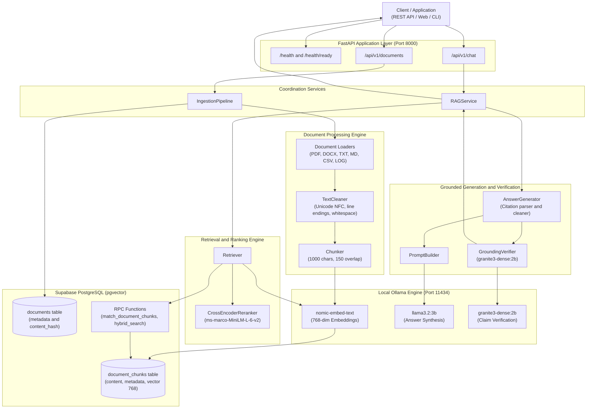
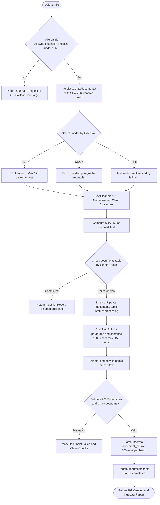
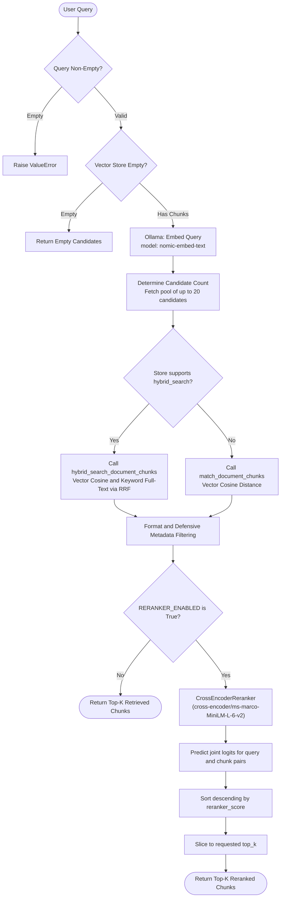
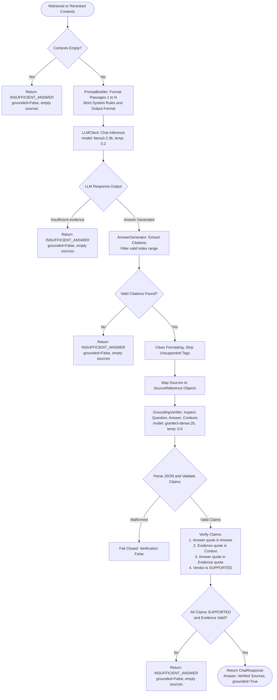
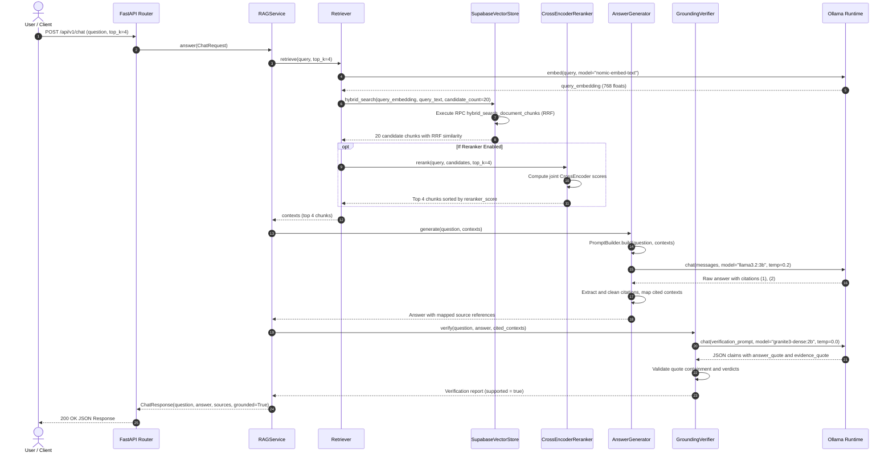
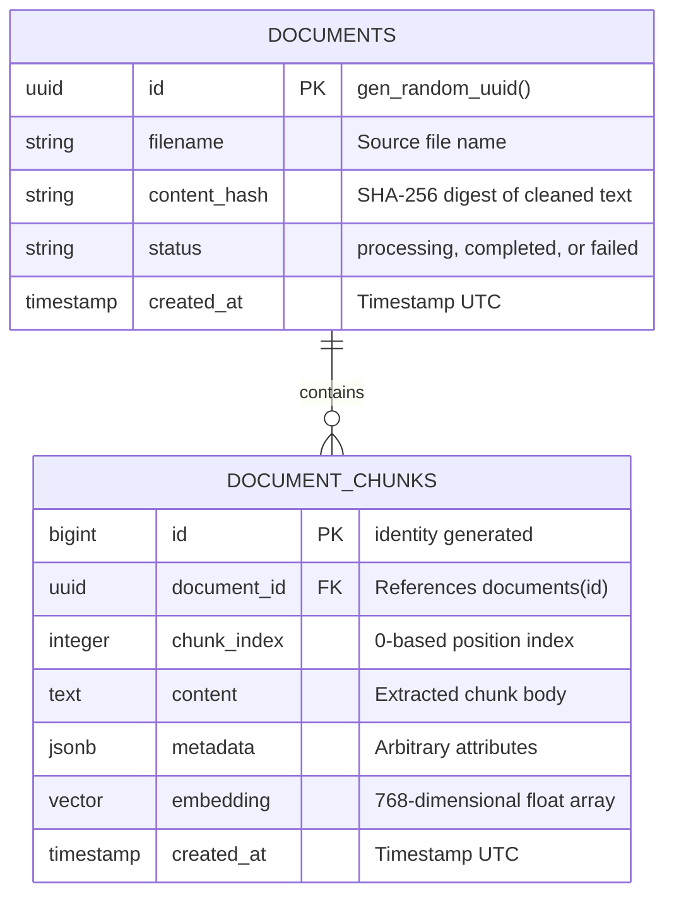
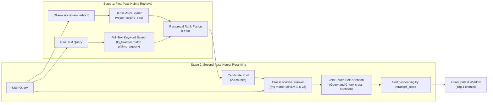
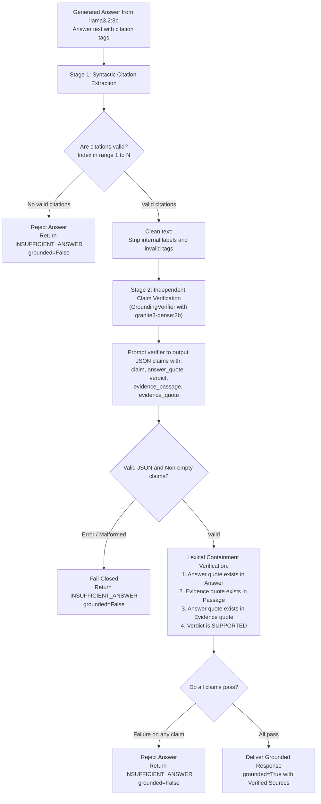

# LocalRAG

A production-grade, local-first Retrieval-Augmented Generation (RAG) system built with **FastAPI**, **Ollama**, **Supabase PostgreSQL (`pgvector`)**, and **Sentence-Transformers**.

LocalRAG executes document parsing, text chunking, vector embedding generation, cross-encoder reranking, answer generation, and claim-level factual grounding verification locally and deterministically. Document vectors and metadata persist in Supabase PostgreSQL with hybrid search capabilities fusing dense vector similarity and full-text keyword retrieval.

---

## Table of Contents

- [1. Project Overview](#1-project-overview)
- [2. Verified Features](#2-verified-features)
- [3. Technology Stack](#3-technology-stack)
- [4. System Architecture](#4-system-architecture)
  - [High-Level Architecture](#high-level-architecture)
  - [Document Ingestion Pipeline](#document-ingestion-pipeline)
  - [Retrieval & Reranking Architecture](#retrieval--reranking-architecture)
  - [Answer Generation & Verification Flow](#answer-generation--verification-flow)
  - [End-to-End Sequence Diagram](#end-to-end-sequence-diagram)
- [5. Project Directory Structure](#5-project-directory-structure)
- [6. System Requirements](#6-system-requirements)
- [7. Installation and Setup](#7-installation-and-setup)
- [8. Environment Variables](#8-environment-variables)
- [9. Database Architecture](#9-database-architecture)
- [10. API Documentation](#10-api-documentation)
- [11. Retrieval and Reranking Deep Dive](#11-retrieval-and-reranking-deep-dive)
- [12. Grounding and Citation Verification](#12-grounding-and-citation-verification)
- [13. Evaluation and Benchmarking](#13-evaluation-and-benchmarking)
- [14. Testing Suite](#14-testing-suite)
- [15. Limitations and Future Improvements](#15-limitations-and-future-improvements)
- [16. License and Contribution](#16-license-and-contribution)

---

## 1. Project Overview

### What the System Does
LocalRAG provides an end-to-end question-answering pipeline over private business and technical documents. Users upload documents via REST API, which are cleaned, chunked, embedded, and indexed. When a user asks a question, the system retrieves the most relevant passages using database-level hybrid search (dense semantic vectors combined with full-text keyword search via Reciprocal Rank Fusion), optionally re-scores them using a deep Cross-Encoder model, synthesizes a cited answer via a local LLM, and independently verifies every factual claim before delivering the response.

### Problem It Solves
- **Data Privacy & Compliance**: Keeps sensitive intellectual property, operational logs, and internal documentation on local infrastructure. Documents and LLM queries are not sent to commercial cloud AI APIs.
- **Hallucination Mitigation**: Enforces strict evidence boundaries in the prompt, verifies citation bracket bounds, and executes a second-stage local LLM verifier with lexical substring containment checking. If an answer cannot be grounded in retrieved passages, the system explicitly abstains.
- **Search Precision**: Solves standard vector-search vocabulary mismatch by fusing vector embeddings with keyword BM25/full-text retrieval (Hybrid Search with RRF) and optional neural cross-encoder reranking.

### Main Technical Approach
1. **Deterministic Preprocessing & Idempotent Ingestion**: Documents are hashed with SHA-256 before insertion. Repeated uploads of identical content are recognized and skipped; retries cleanly purge previous partial chunks.
2. **Local Vector & LLM Inference**: Embeddings are computed via Ollama (`nomic-embed-text`, 768 dimensions). Answer generation runs on Ollama (`llama3.2:3b`), and grounding verification runs on Ollama (`granite3-dense:2b`).
3. **Database-Backed Hybrid Search**: Supabase PostgreSQL with `pgvector` hosts chunk embeddings and metadata. An RPC function combines dense cosine distance with PostgreSQL full-text search via Reciprocal Rank Fusion (RRF).
4. **Two-Stage Validation & Fail-Closed Abstention**:
   - Stage 1: Syntactic validation of citations (`[1]`, `[2]`), stripping hallucinated references and confirming citation range.
   - Stage 2: Independent verification via `GroundingVerifier`, which extracts atomic claims, checks answer quotes, validates evidence quotes against retrieved passages, and verifies that the answer quote is contained within the evidence sentence. Any unverified claim forces an automatic abstention fallback.

---

## 2. Verified Features

| Feature | Implementation Details |
|---|---|
| **Multi-Format Document Ingestion** | Ingests `.pdf`, `.docx`, `.txt`, `.md`, `.csv`, and `.log` files up to 10 MB per file. Uploaded files are stored in `data/documents/` prefixed with a 16-character content hash to prevent collisions. |
| **PDF Extraction** | Implemented via PyMuPDF (`PDFLoader`), extracting text page-by-page while tracking `page_number`, checking for encryption/passwords, and detecting unscannable documents. |
| **Word Document Parsing** | Implemented via `python-docx` (`DOCXLoader`), extracting paragraphs and structured table cells formatted as pipe-separated rows (e.g. `cell1 / cell2`). |
| **Plain Text & Delimited Text** | Implemented via `TextLoader`, featuring automatic encoding fallback (`utf-8-sig`, `utf-8`, `cp1252`, `latin-1`) for logs, CSV files, and markdown notes. |
| **Text Cleaning & Normalization** | Implemented in `TextCleaner`: Unicode NFC normalization, CRLF/CR to LF normalization, form-feed conversion, control/surrogate character stripping, tab-to-space expansion (4 spaces), trailing whitespace stripping, and blank line coalescing (maximum 1 blank line between blocks). |
| **Deterministic Structure-Aware Chunking** | Implemented in `Chunker`: Splits text into configurable overlapping chunks (default 1000 characters, 150 characters overlap). Respects paragraph breaks (`\n\n`), sentence boundaries, and word boundaries. Overlap context from prior segments is preserved across chunk boundaries without truncation. |
| **Idempotent Ingestion & Duplicate Detection** | Generates a SHA-256 digest of cleaned text. If the document already exists in `documents` with status `completed`, ingestion skips re-indexing. If retrying a failed/partial ingestion, existing chunks are purged before re-indexing. |
| **Local 768-Dim Embedding Generation** | Uses `ollama.embed` with model `nomic-embed-text`. Validates that returned vectors strictly match chunk counts and have exactly 768 dimensions before persisting. |
| **Supabase pgvector Storage** | Batched inserts (100 rows per batch) into `document_chunks`. Stores vector embeddings (`vector(768)`), chunk index, document foreign key, content, and JSONB metadata. |
| **Vector Similarity Search** | Calls PostgreSQL RPC `match_document_chunks` using cosine distance (`<=>` operator) with similarity calculation `1 - (embedding <=> query_embedding)`. |
| **Hybrid Search with Reciprocal Rank Fusion (RRF)** | Calls PostgreSQL RPC `hybrid_search_document_chunks`, executing dense vector search and full-text keyword search in parallel, combining ranks using RRF ($k=60$). |
| **Metadata Filtering** | Supported via `match_document_chunks_filtered` and verified in-memory within `SupabaseVectorStore._format_results`. |
| **Optional Cross-Encoder Reranking** | Implemented via `CrossEncoderReranker` using `sentence-transformers` model `cross-encoder/ms-marco-MiniLM-L-6-v2`. Re-scores candidate pairs on CPU or CUDA GPU. |
| **Prompt Construction with Untrusted Evidence Boundary** | Implemented in `PromptBuilder`: Injects retrieved contexts with explicit source headers (`PASSAGE NUMBER`, `SOURCE FILE`, `PAGE NUMBER`, `DOCUMENT ID`). Strict instructions command the LLM to treat contexts as passive evidence, never as instructions. |
| **Grounded Answer Generation** | Implemented in `AnswerGenerator` using Ollama (`llama3.2:3b`). Prompts demand concise answers followed by bracketed citations (`[1]`, `[2]`). Validates citation ranges and strips hallucinated citations. |
| **Claim-Level Factual Grounding Verification** | Implemented in `GroundingVerifier`: Uses an independent local model (`granite3-dense:2b`) at `temperature=0.0`. Validates that `answer_quote` is present in the answer, `evidence_quote` is present in the context passage, and `answer_quote` is contained within `evidence_quote`. |
| **Strict Abstention Fallback** | When evidence is missing, unretrieved, or verification fails, the system returns: `"The provided documents do not contain enough information to answer this."` with `grounded=False`. |
| **Evaluation & Quality Benchmarking** | Automated evaluation script `scripts/evaluate_rag.py` computing Recall@k, Precision@k, HitRate@k, MRR, Answer Accuracy, Abstention Accuracy, Grounded Answer Rate, and Average Latency over 25 labeled test cases. |

---

## 3. Technology Stack

| Layer | Component | Version / Identifier | Purpose |
|---|---|---|---|
| **Backend Framework** | FastAPI | `>=0.110.0` | Asynchronous REST API routing, OpenAPI docs, and HTTP exception handling |
| **ASGI Server** | Uvicorn (standard) | `>=0.28.0` | High-performance asynchronous web server |
| **Programming Language** | Python | `>=3.10` (tested on 3.10.11) | Core application runtime |
| **Vector Database** | Supabase (PostgreSQL 15+) | `supabase>=2.0.0` | Relational storage for documents, pgvector for semantic search & RPC |
| **Vector Search Extension** | pgvector | PostgreSQL extension | Vector indexing (`vector(768)`), cosine distance, and hybrid search |
| **Local Inference Runtime** | Ollama | `>=0.1.7` (REST API) | Local execution of embedding, generation, and verification models |
| **Embedding Model** | `nomic-embed-text` | 768 dimensions | High-performance open-source text embeddings |
| **Primary Chat Model** | `llama3.2:3b` | 3 billion parameters | Instruction-tuned local LLM for answer generation |
| **Grounding Verifier Model**| `granite3-dense:2b` | 2 billion parameters | Factual claim extraction and evidence entailment verification |
| **Neural Reranker** | `sentence-transformers` | `>=6.2.0` (`ms-marco-MiniLM-L-6-v2`) | Cross-encoder relevance re-scoring over top candidate chunks |
| **Hardware Acceleration** | PyTorch / CUDA | `torch` (dynamic detection) | Automatic GPU offloading for cross-encoder reranking when available |
| **Document Parsers** | PyMuPDF (`pymupdf`), `python-docx`| `>=1.23.0`, `>=1.1.0` | PDF page-level parsing and DOCX paragraph/table extraction |
| **Data Validation** | Pydantic v2 & `pydantic-settings` | `>=2.6.0`, `>=2.2.0` | Type enforcement, schema validation, and `.env` loading |
| **HTTP Client** | HTTPX | `>=0.27.0` | Asynchronous/synchronous HTTP communication with retries |
| **File Upload Handling** | `python-multipart` | `>=0.0.9` | Multipart form-data handling for document uploads |
| **Test Framework** | pytest & pytest-asyncio | `>=8.0.0`, `>=0.23.0` | Unit, integration, and evaluation test suites |
| **Linter & Formatter** | Ruff | `>=0.3.0` | Code styling, type checks, and import sorting |

---

## 4. System Architecture

### High-Level Architecture



---

### Document Ingestion Pipeline



---

### Retrieval & Reranking Architecture



---

### Answer Generation & Verification Flow



---

### End-to-End Sequence Diagram



---

## 5. Project Directory Structure

```text
D:\rag
├── app/
│   ├── __init__.py                  # Application package marker
│   ├── main.py                      # FastAPI entry point, lifespan, logging setup, router mounting
│   ├── api/                         # HTTP API assembly and endpoint controllers
│   │   ├── __init__.py
│   │   ├── dependencies.py          # Dependency injection providers (get_app_settings)
│   │   ├── router.py                # Central APIRouter mounting health, documents, and chat
│   │   └── routes/
│   │       ├── __init__.py
│   │       ├── health.py            # Liveness (/health) and readiness (/health/ready) probes
│   │       ├── documents.py         # Document ingestion (/upload), listing, retrieval, deletion
│   │       └── chat.py              # Grounded QA conversational endpoint (/api/v1/chat)
│   ├── core/                        # Cross-cutting foundational utilities and settings
│   │   ├── __init__.py
│   │   ├── config.py                # Pydantic BaseSettings loading .env configuration
│   │   ├── constants.py             # File extensions, chunk sizes, and model identifiers
│   │   ├── exceptions.py            # Domain exceptions (DocumentParsingError, VectorStoreError, etc.)
│   │   └── logging.py               # Structured application logging configuration
│   ├── schemas/                     # Pydantic data transfer objects (DTOs)
│   │   ├── __init__.py
│   │   ├── chat.py                  # ChatRequest, ChatResponse, SourceReference
│   │   ├── document.py              # DocumentMetadata, DocumentChunk, IngestionReport
│   │   └── retrieval.py             # Retrieval DTO interfaces (stubs)
│   ├── ingestion/                   # Ingestion pipeline, parsers, cleaner, and chunker
│   │   ├── __init__.py
│   │   ├── pipeline.py              # IngestionPipeline orchestrating load -> clean -> chunk -> embed -> store
│   │   ├── text_cleaner.py          # TextCleaner with Unicode NFC normalization and whitespace control
│   │   ├── chunker.py               # Chunker with paragraph/sentence splitting and overlap retention
│   │   └── loaders/                 # File format loaders
│   │       ├── __init__.py
│   │       ├── base.py              # BaseLoader abstract interface and LoadedDocument dataclass
│   │       ├── pdf_loader.py        # PDFLoader using PyMuPDF (fitz)
│   │       ├── docx_loader.py       # DOCXLoader using python-docx
│   │       └── text_loader.py       # TextLoader supporting .txt, .md, .csv, .log with encoding fallback
│   ├── embeddings/                  # Embedding abstraction layer
│   │   ├── __init__.py
│   │   ├── base.py                  # BaseEmbeddings abstract interface (stub)
│   │   └── ollama_embeddings.py     # OllamaEmbeddings class definition (stub)
│   ├── vectorstore/                 # Vector database implementations
│   │   ├── __init__.py
│   │   ├── base.py                  # BaseVectorStore abstract interface
│   │   └── supabase_store.py        # SupabaseVectorStore: pgvector storage, similarity & hybrid search
│   ├── retrieval/                   # Retrieval and ranking engine
│   │   ├── __init__.py
│   │   ├── retriever.py             # Retriever engine coordinating query embedding, search, and reranking
│   │   ├── reranker.py              # CrossEncoderReranker using SentenceTransformers
│   │   ├── filters.py               # Metadata filter parser (stub)
│   │   ├── metrics.py               # IR metrics: recall_at_k, precision_at_k, hit_rate_at_k, mrr
│   │   └── supabase_store.py        # Standalone Supabase client helper and connection test script
│   ├── generation/                  # Generation, prompt engineering, and verification
│   │   ├── __init__.py
│   │   ├── llm_client.py            # LLMClient: Ollama HTTP client with retry and timeout management
│   │   ├── prompt_builder.py        # PromptBuilder: Constructing isolated untrusted evidence prompts
│   │   ├── answer_generator.py      # AnswerGenerator: LLM generation, citation extraction & cleaning
│   │   └── grounding_verifier.py    # GroundingVerifier: Claim extraction & lexical quote verification
│   ├── services/                    # High-level orchestration services
│   │   ├── __init__.py
│   │   ├── rag_service.py           # RAGService: End-to-end retrieval, generation, and verification
│   │   └── ingestion_service.py     # High-level IngestionService coordinator (stub)
│   └── utils/                       # Shared utility helpers
│       ├── __init__.py
│       ├── file_utils.py            # File extension verification helpers
│       └── hashing.py               # Cryptographic SHA-256 content hashing
├── data/                            # Local operational data storage
│   ├── cache/                       # Local model and embedding cache
│   ├── chroma_db/                   # Legacy directory marker (Supabase pgvector is active store)
│   ├── documents/                   # Uploaded source documents storage
│   ├── evaluation/                  # Temporary evaluation working data
│   └── evaluation_documents/        # 24 synthetic corpus text files used for RAG benchmarking
├── docs/                            # Internal design and architecture notes
│   ├── architecture.md              # Architectural overview and design principles
│   ├── development.md               # Developer onboarding guide
│   └── prd.md                       # Product Requirements Document
├── reports/                         # Benchmark evaluation reports and ingestion manifests
│   ├── eval_ingestion_manifest.json # Tracking manifest for evaluation corpus documents
│   ├── rag_eval_baseline.json       # Benchmark metrics for hybrid search baseline (Reranker OFF)
│   ├── rag_eval_reranked.json       # Benchmark metrics with Cross-Encoder (Reranker ON)
│   ├── rag_eval_reranked_final.json # Final verified benchmark metrics with Cross-Encoder reranking
│   └── rag_eval_report.json         # Latest execution evaluation report
├── scripts/                         # Operational CLI scripts and diagnostics
│   ├── check_environment.py         # Pre-flight environment validation (Python, directories, Ollama)
│   ├── create_eval_corpus.py        # Generates synthetic evaluation documents
│   ├── ingest_documents.py          # CLI runner stub for document ingestion
│   ├── ingest_eval_corpus.py        # Bulk ingestion script for evaluation corpus into Supabase
│   ├── reindex_documents.py         # CLI runner stub for database reindexing
│   ├── evaluate_rag.py              # Benchmark execution script computing IR and QA metrics
│   └── debug_*.py                   # Diagnostic scripts for generation and verification testing
├── tests/                           # Complete automated test suite (131 tests)
│   ├── conftest.py                  # Pytest fixtures and shared configuration
│   ├── unit/                        # 62 isolated unit tests (chunker, cleaner, reranker, verifier, etc.)
│   ├── integration/                 # 47 integration tests (ingestion pipeline, vectorstore, rag_service)
│   └── evaluation/                  # 22 evaluation tests (retrieval metrics, citation grounding)
│       └── datasets/
│           └── rag_eval.json        # 25 labeled ground-truth questions (20 answerable, 5 unanswerable)
├── .env                             # Active environment variable definitions (git-ignored)
├── .gitignore                       # Git ignore specifications
├── LICENSE                          # MIT License specification
├── pyproject.toml                   # Project metadata, Ruff rules, and pytest configurations
├── pytest.ini                       # Pytest test discovery and marker definitions
├── requirements.txt                 # Core runtime dependencies
└── requirements-dev.txt             # Development and testing dependencies
```

> [!NOTE]
> **Implementation Note on Subsystem Stubs**:
> As verified in the repository audit, `app/embeddings/base.py`, `app/embeddings/ollama_embeddings.py`, `app/retrieval/filters.py`, `app/schemas/retrieval.py`, and `app/services/ingestion_service.py` contain initial structural stubs with `TODO` markers. The active codebase directly invokes `ollama.embed` inside `app/ingestion/pipeline.py` and `app/retrieval/retriever.py`, handles ingestion orchestration via `IngestionPipeline`, and controls API endpoints via `app/api/routes/documents.py`.

---

## 6. System Requirements

### Runtime Prerequisites
- **Operating System**: Windows 10/11 (x64), Linux (x86_64), or macOS (Apple Silicon / Intel). Commands in this guide are tailored for Windows PowerShell.
- **Python**: Python `3.10.x`, `3.11.x`, or `3.12.x` (64-bit).
- **Ollama**: Locally installed and active background daemon (`ollama serve`).
- **Supabase Account / Instance**: Active Supabase project (hosted or self-hosted PostgreSQL 15+) with `pgvector` enabled.

### Required Models

| Model Name | Runtime | Disk Size | Purpose | Command to Pull |
|---|---|---|---|---|
| `nomic-embed-text` | Ollama | ~274 MB | 768-dimensional document and query embeddings | `ollama pull nomic-embed-text` |
| `llama3.2:3b` | Ollama | ~2.0 GB | Primary response generation and synthesis | `ollama pull llama3.2:3b` |
| `granite3-dense:2b` | Ollama | ~1.6 GB | Factual grounding and claim-level verification | `ollama pull granite3-dense:2b` |
| `cross-encoder/ms-marco-MiniLM-L-6-v2` | PyTorch / HF | ~80 MB | Neural candidate reranking (optional) | *Auto-downloaded on first run* |

### Hardware Recommendations
- **Minimum (CPU Only)**:
  - 4 physical CPU cores (x86_64 or ARM64).
  - 8 GB system RAM.
  - 10 GB free disk space for models, virtual environment, and local documents.
- **Recommended (Hardware Accelerated)**:
  - 8+ CPU cores.
  - 16 GB+ system RAM.
  - Dedicated NVIDIA GPU with 6 GB+ VRAM (supporting CUDA) for low-latency LLM inference and sub-second Cross-Encoder reranking.

---

## 7. Installation and Setup

Follow these exact steps in Windows PowerShell to set up and run LocalRAG:

### Step 1: Open Project Directory
```powershell
cd D:\rag
```

### Step 2: Create and Activate Virtual Environment
```powershell
python -m venv .venv
.\.venv\Scripts\Activate.ps1
```

### Step 3: Install Dependencies
```powershell
pip install -r requirements-dev.txt
```

### Step 4: Install and Start Ollama
1. Download Ollama for Windows from [ollama.ai](https://ollama.ai/).
2. Run the installer and launch Ollama. Verify the service is running:
   ```powershell
   Invoke-RestMethod -Uri http://127.0.0.1:11434/api/tags
   ```

### Step 5: Pull Required Ollama Models
```powershell
ollama pull nomic-embed-text
ollama pull llama3.2:3b
ollama pull granite3-dense:2b
```

### Step 6: Configure Environment Variables
Create a `.env` file in the project root (`D:\rag\.env`):
```ini
# Application Configuration
APP_NAME=LocalRAG
APP_ENV=development
APP_HOST=127.0.0.1
APP_PORT=8000
LOG_LEVEL=INFO

# Ollama Configuration
OLLAMA_BASE_URL=http://127.0.0.1:11434
OLLAMA_EMBED_MODEL=nomic-embed-text
OLLAMA_CHAT_MODEL=llama3.2:3b

# Supabase pgvector Configuration
SUPABASE_URL=https://your-project-id.supabase.co
SUPABASE_KEY=your-supabase-service-role-or-anon-key
SUPABASE_TABLE_NAME=document_chunks

# Storage Configuration
DOCUMENTS_DIR=data/documents

# Ingestion and Retrieval Parameters
CHUNK_SIZE=1000
CHUNK_OVERLAP=150
RETRIEVAL_TOP_K=4

# Cross-Encoder Reranker Settings
RERANKER_ENABLED=false
RERANKER_MODEL=cross-encoder/ms-marco-MiniLM-L-6-v2
RERANKER_CANDIDATES=20
```

### Step 7: Configure Supabase Database Schema
Execute the following SQL in your Supabase SQL Editor to configure tables, indexes, and RPC functions:

```sql
-- 1. Enable the pgvector extension
CREATE EXTENSION IF NOT EXISTS vector;

-- 2. Create the documents tracking table
CREATE TABLE IF NOT EXISTS documents (
    id UUID PRIMARY KEY DEFAULT gen_random_uuid(),
    filename TEXT NOT NULL,
    content_hash TEXT NOT NULL,
    status TEXT NOT NULL DEFAULT 'processing',
    created_at TIMESTAMP WITH TIME ZONE DEFAULT timezone('utc'::text, now()) NOT NULL
);

CREATE INDEX IF NOT EXISTS idx_documents_content_hash ON documents(content_hash);

-- 3. Create the document_chunks table
CREATE TABLE IF NOT EXISTS document_chunks (
    id BIGINT GENERATED BY DEFAULT AS IDENTITY PRIMARY KEY,
    document_id UUID NOT NULL REFERENCES documents(id) ON DELETE CASCADE,
    chunk_index INTEGER NOT NULL,
    content TEXT NOT NULL,
    metadata JSONB DEFAULT '{}'::jsonb,
    embedding VECTOR(768),
    created_at TIMESTAMP WITH TIME ZONE DEFAULT timezone('utc'::text, now()) NOT NULL
);

CREATE INDEX IF NOT EXISTS idx_document_chunks_document_id ON document_chunks(document_id);
CREATE INDEX IF NOT EXISTS idx_document_chunks_embedding ON document_chunks USING hnsw (embedding vector_cosine_ops);
CREATE INDEX IF NOT EXISTS idx_document_chunks_metadata ON document_chunks USING gin (metadata);
CREATE INDEX IF NOT EXISTS idx_document_chunks_content_fts ON document_chunks USING gin (to_tsvector('english', content));

-- 4. Standard Vector Cosine Similarity Search RPC
CREATE OR REPLACE FUNCTION match_document_chunks (
    query_embedding VECTOR(768),
    match_count INT DEFAULT 4,
    match_threshold FLOAT DEFAULT 0.0
)
RETURNS TABLE (
    chunk_id BIGINT,
    document_id UUID,
    content TEXT,
    metadata JSONB,
    similarity FLOAT
)
LANGUAGE plpgsql
AS $$
BEGIN
    RETURN QUERY
    SELECT
        dc.id AS chunk_id,
        dc.document_id,
        dc.content,
        dc.metadata,
        1 - (dc.embedding <=> query_embedding) AS similarity
    FROM document_chunks dc
    WHERE 1 - (dc.embedding <=> query_embedding) >= match_threshold
    ORDER BY dc.embedding <=> query_embedding ASC
    LIMIT match_count;
END;
$$;

-- 5. Filtered Vector Similarity Search RPC
CREATE OR REPLACE FUNCTION match_document_chunks_filtered (
    query_embedding VECTOR(768),
    match_count INT DEFAULT 20,
    match_threshold FLOAT DEFAULT 0.0,
    metadata_filter JSONB DEFAULT '{}'::jsonb
)
RETURNS TABLE (
    chunk_id BIGINT,
    document_id UUID,
    content TEXT,
    metadata JSONB,
    similarity FLOAT
)
LANGUAGE plpgsql
AS $$
BEGIN
    RETURN QUERY
    SELECT
        dc.id AS chunk_id,
        dc.document_id,
        dc.content,
        dc.metadata,
        1 - (dc.embedding <=> query_embedding) AS similarity
    FROM document_chunks dc
    WHERE 1 - (dc.embedding <=> query_embedding) >= match_threshold
      AND (metadata_filter = '{}'::jsonb OR dc.metadata @> metadata_filter)
    ORDER BY dc.embedding <=> query_embedding ASC
    LIMIT match_count;
END;
$$;

-- 6. Hybrid Search RPC with Reciprocal Rank Fusion (RRF)
CREATE OR REPLACE FUNCTION hybrid_search_document_chunks (
    p_query_embedding VECTOR(768),
    p_query_text TEXT,
    p_match_count INT DEFAULT 4,
    p_metadata_filter JSONB DEFAULT '{}'::jsonb
)
RETURNS TABLE (
    chunk_id BIGINT,
    document_id UUID,
    content TEXT,
    metadata JSONB,
    similarity FLOAT
)
LANGUAGE plpgsql
AS $$
DECLARE
    k CONSTANT INT := 60;
BEGIN
    RETURN QUERY
    WITH vector_matches AS (
        SELECT
            dc.id,
            ROW_NUMBER() OVER (ORDER BY dc.embedding <=> p_query_embedding ASC) AS rank
        FROM document_chunks dc
        WHERE (p_metadata_filter = '{}'::jsonb OR dc.metadata @> p_metadata_filter)
        LIMIT 50
    ),
    keyword_matches AS (
        SELECT
            dc.id,
            ROW_NUMBER() OVER (ORDER BY ts_rank_cd(to_tsvector('english', dc.content), plainto_tsquery('english', p_query_text)) DESC) AS rank
        FROM document_chunks dc
        WHERE to_tsvector('english', dc.content) @@ plainto_tsquery('english', p_query_text)
          AND (p_metadata_filter = '{}'::jsonb OR dc.metadata @> p_metadata_filter)
        LIMIT 50
    ),
    combined_scores AS (
        SELECT
            COALESCE(v.id, k_m.id) AS id,
            COALESCE(1.0 / (k + v.rank), 0.0) + COALESCE(1.0 / (k + k_m.rank), 0.0) AS rrf_score
        FROM vector_matches v
        FULL OUTER JOIN keyword_matches k_m ON v.id = k_m.id
    )
    SELECT
        dc.id AS chunk_id,
        dc.document_id,
        dc.content,
        dc.metadata,
        cs.rrf_score::FLOAT AS similarity
    FROM combined_scores cs
    JOIN document_chunks dc ON cs.id = dc.id
    ORDER BY cs.rrf_score DESC
    LIMIT p_match_count;
END;
$$;
```

### Step 8: Verify Environment
Run the included pre-flight environment check:
```powershell
python scripts/check_environment.py
```

### Step 9: Start the Application Server
```powershell
uvicorn app.main:app --host 127.0.0.1 --port 8000 --reload
```

### Step 10: Verify Application Health
In a separate terminal:
```powershell
Invoke-RestMethod -Uri http://127.0.0.1:8000/health
```
Expected response:
```json
{"status": "ok", "app": "LocalRAG"}
```

Access the interactive API documentation at:
- Swagger UI: `http://127.0.0.1:8000/docs`
- ReDoc: `http://127.0.0.1:8000/redoc`

---

## 8. Environment Variables

All configuration properties are loaded from `.env` via `app.core.config.Settings`:

| Variable | Type | Purpose | Default | Required |
|---|---|---|---|---|
| `APP_NAME` | string | Name of the application | `"LocalRAG"` | No |
| `APP_ENV` | string | Execution environment (`development`, `production`) | `"development"` | No |
| `APP_HOST` | string | Host address to bind the web server | `"127.0.0.1"` | No |
| `APP_PORT` | integer | Port to bind the web server | `8000` | No |
| `OLLAMA_BASE_URL` | string | Base URL of the Ollama HTTP API | `"http://127.0.0.1:11434"` | No |
| `OLLAMA_EMBED_MODEL` | string | Identifier of Ollama embedding model | `"nomic-embed-text"` | No |
| `OLLAMA_CHAT_MODEL` | string | Identifier of primary Ollama chat model | `"llama3.2:3b"` | No |
| `SUPABASE_URL` | string | HTTPS URL of your Supabase project instance | `""` | **Yes** |
| `SUPABASE_KEY` | string | Supabase service-role or anon API key | `""` | **Yes** |
| `SUPABASE_TABLE_NAME`| string | Primary table for chunk vector storage | `"document_chunks"` | No |
| `DOCUMENTS_DIR` | Path | Local directory for storing uploaded files | `Path("data/documents")` | No |
| `CHUNK_SIZE` | integer | Maximum character size per document chunk | `1000` | No |
| `CHUNK_OVERLAP` | integer | Character overlap between adjacent chunks | `150` | No |
| `RETRIEVAL_TOP_K` | integer | Default number of chunks to return for QA | `4` | No |
| `RERANKER_ENABLED` | boolean | Toggle Cross-Encoder candidate reranking | `false` | No |
| `RERANKER_MODEL` | string | Sentence-Transformers Cross-Encoder model | `"cross-encoder/ms-marco-MiniLM-L-6-v2"` | No |
| `RERANKER_CANDIDATES`| integer | Number of initial candidates fetched before rerank | `20` | No |
| `LOG_LEVEL` | string | Logging verbosity (`DEBUG`, `INFO`, `WARNING`, `ERROR`)| `"INFO"` | No |

---

## 9. Database Architecture

The persistence model separates high-level document records from individual text chunks and high-dimensional vector embeddings.

### Entity Relationship Diagram



### Table Specifications

#### 1. `documents` Table
- **`id`** (`UUID`, Primary Key): Unique document identifier.
- **`filename`** (`TEXT`, Not Null): Original uploaded file name.
- **`content_hash`** (`TEXT`, Not Null): Cryptographic SHA-256 hash calculated over the entire cleaned text of all loaded pages. Enforces idempotency and prevents duplicate chunk generation.
- **`status`** (`TEXT`, Not Null): Ingestion state:
  - `processing`: Document has been registered and is being chunked/embedded.
  - `completed`: Chunks and embeddings are successfully persisted.
  - `failed`: Document encountered an unrecoverable failure during ingestion.
- **`created_at`** (`TIMESTAMPTZ`, Not Null): Ingestion timestamp.

#### 2. `document_chunks` Table
- **`id`** (`BIGINT`, Primary Key): Identity sequence chunk identifier.
- **`document_id`** (`UUID`, Foreign Key): References `documents(id)` with `ON DELETE CASCADE`.
- **`chunk_index`** (`INTEGER`, Not Null): Sequential ordering position of the chunk in the document.
- **`content`** (`TEXT`, Not Null): Cleaned text content of the chunk.
- **`metadata`** (`JSONB`): Key-value store containing `filename`, `path`, `file_type`, `page_number`, and `file_size`.
- **`embedding`** (`VECTOR(768)`): Dense embedding vector produced by `nomic-embed-text`.
- **`created_at`** (`TIMESTAMPTZ`, Not Null): Creation timestamp.

### Database Indexing Strategy
- **Vector Index**: HNSW index (`USING hnsw (embedding vector_cosine_ops)`) provides sub-millisecond approximate nearest neighbor (ANN) retrieval using cosine distance.
- **Keyword Index**: GIN index over full-text search vector (`to_tsvector('english', content)`).
- **Metadata Index**: GIN index (`USING gin (metadata)`) accelerates arbitrary JSONB attribute matching.

---

## 10. API Documentation

### 1. Health Liveness Probe
- **Method & Path**: `GET /health`
- **Purpose**: Liveness probe confirming the FastAPI application is alive.
- **Request Parameters**: None.
- **Response** (`200 OK`):
  ```json
  {
    "status": "ok",
    "app": "LocalRAG"
  }
  ```

### 2. Health Readiness Probe
- **Method & Path**: `GET /health/ready`
- **Purpose**: Readiness probe confirming readiness to accept traffic.
- **Request Parameters**: None.
- **Response** (`200 OK`):
  ```json
  {
    "status": "ready"
  }
  ```

### 3. Upload & Ingest Document
- **Method & Path**: `POST /api/v1/documents/upload`
- **Purpose**: Upload a document (`.pdf`, `.docx`, `.txt`, `.md`, `.csv`, `.log`), clean text, chunk, embed with Ollama, and index in Supabase.
- **Content-Type**: `multipart/form-data`
- **Request Body**:
  - `file`: Binary file upload (maximum 10 MB).
- **Example cURL**:
  ```bash
  curl -X POST "http://127.0.0.1:8000/api/v1/documents/upload" \
    -F "file=@D:/docs/project_spec.pdf"
  ```
- **Response** (`201 Created`):
  ```json
  {
    "message": "Document successfully ingested into Supabase.",
    "document_id": "c1f7a4b2-8419-4b68-96f3-18967912d1b8",
    "filename": "project_spec.pdf",
    "status": "completed",
    "chunks_created": 14,
    "content_hash": "e3b0c44298fc1c149afbf4c8996fb92427ae41e4649b934ca495991b7852b855"
  }
  ```
- **Error Responses**:
  - `400 Bad Request`: Empty file, unsupported file extension, or unextractable text.
  - `413 Payload Too Large`: Uploaded file exceeds 10 MB limit.
  - `500 Internal Server Error`: Parsing or embedding pipeline failure.

### 4. List Documents
- **Method & Path**: `GET /api/v1/documents`
- **Purpose**: Retrieve a list of up to 100 most recent indexed documents.
- **Response** (`200 OK`):
  ```json
  {
    "documents": [
      {
        "id": "c1f7a4b2-8419-4b68-96f3-18967912d1b8",
        "filename": "project_spec.pdf",
        "content_hash": "e3b0c44298fc1c149afbf4c8996fb92427ae41e4649b934ca495991b7852b855",
        "status": "completed",
        "created_at": "2026-11-08T00:15:30.123456+00:00"
      }
    ]
  }
  ```

### 5. Get Document Metadata
- **Method & Path**: `GET /api/v1/documents/{document_id}`
- **Purpose**: Retrieve metadata for a single document by its UUID.
- **Path Parameters**:
  - `document_id` (`UUID`): Document identifier.
- **Response** (`200 OK`):
  ```json
  {
    "id": "c1f7a4b2-8419-4b68-96f3-18967912d1b8",
    "filename": "project_spec.pdf",
    "content_hash": "e3b0c44298fc1c149afbf4c8996fb92427ae41e4649b934ca495991b7852b855",
    "status": "completed",
    "created_at": "2026-11-08T00:15:30.123456+00:00"
  }
  ```
- **Error Responses**:
  - `404 Not Found`: If no document matches the provided UUID.

### 6. Delete Document
- **Method & Path**: `DELETE /api/v1/documents/{document_id}`
- **Purpose**: Purge all associated chunks from `document_chunks` and delete the document from `documents`.
- **Path Parameters**:
  - `document_id` (`UUID`): Document identifier.
- **Response** (`200 OK`):
  ```json
  {
    "message": "Document and associated chunks deleted.",
    "document_id": "c1f7a4b2-8419-4b68-96f3-18967912d1b8"
  }
  ```
- **Error Responses**:
  - `404 Not Found`: Document not found.

### 7. Grounded Chat & Question Answering
- **Method & Path**: `POST /api/v1/chat`
- **Purpose**: Execute retrieval, optional reranking, prompt synthesis, citation parsing, and independent factual claim verification to return a grounded answer.
- **Request Body**:
  ```json
  {
    "question": "Which backend framework does Project Orion use?",
    "top_k": 4
  }
  ```
- **Response - Answerable & Grounded** (`200 OK`):
  ```json
  {
    "question": "Which backend framework does Project Orion use?",
    "answer": "Project Orion uses FastAPI as its backend framework. [1]",
    "sources": [
      {
        "document_id": "c1f7a4b2-8419-4b68-96f3-18967912d1b8",
        "chunk_id": "42",
        "filename": "project_orion.txt",
        "content": "Project Orion is an inventory management platform. Its backend framework is FastAPI.",
        "similarity": 0.032258,
        "metadata": {
          "filename": "project_orion.txt",
          "file_type": ".txt",
          "page_number": "Not available"
        }
      }
    ],
    "grounded": true
  }
  ```
- **Response - Unanswerable / Ungrounded** (`200 OK`):
  ```json
  {
    "question": "Who is the CEO of Project Orion?",
    "answer": "The provided documents do not contain enough information to answer this.",
    "sources": [],
    "grounded": false
  }
  ```
- **Error Responses**:
  - `400 Bad Request`: Empty or whitespace-only question.
  - `500 Internal Server Error`: Downstream inference or database failure.

---

## 11. Retrieval and Reranking Deep Dive

LocalRAG employs a multi-stage retrieval architecture designed to maximize both high-recall candidate selection and high-precision context delivery.



### Stage 1: Hybrid Retrieval & Reciprocal Rank Fusion (RRF)
Vector similarity alone frequently suffers from keyword misses on specific entity names, codes, or IDs (e.g., "Project Q-402"). Pure keyword search fails on semantic paraphrasing. LocalRAG solves this by executing both in PostgreSQL and merging them with Reciprocal Rank Fusion:

$$RRF\_score(d) = \sum_{m \in M} \frac{1}{k + rank_m(d)}$$

Where:
- $M$: The set of retrieval systems (dense vector search and full-text keyword search).
- $k$: Constant smoothing parameter set to $60$.
- $rank_m(d)$: The ordinal rank of document $d$ within retrieval system $m$ (1-indexed).

The `similarity` attribute returned by `SupabaseVectorStore.hybrid_search` represents this computed RRF score.

### Stage 2: Cross-Encoder Neural Reranking
When `RERANKER_ENABLED=true` is set:
1. First-pass retrieval fetches $N=20$ candidates (`RERANKER_CANDIDATES`).
2. Candidate texts are paired with the query: `(query, chunk_content)`.
3. The pairs are evaluated by `CrossEncoderReranker` using `cross-encoder/ms-marco-MiniLM-L-6-v2` (`max_length=512`, `batch_size=16`).
4. Unlike bi-encoders (which compute embeddings independently), the cross-encoder feeds both query and document into cross-attention layers simultaneously, capturing fine-grained token-level interactions.
5. Candidates receive a continuous `reranker_score` (unbounded logit) and are sorted in descending order.
6. The candidate list is sliced to the final requested `top_k` (default 4).

---

## 12. Grounding and Citation Verification

Hallucination prevention in LocalRAG operates as a strict two-stage defensive gate.



### Citation Extraction & Sanitization (`AnswerGenerator`)
1. **Extraction**: `re.findall(r"\[(\d+)\]", answer)` locates all bracketed integers.
2. **Range Verification**: Numbers outside `1 <= N <= len(contexts)` are rejected.
3. **Cleaning**:
   - Strips redundant `Sources:` blocks emitted by the model.
   - Removes leading `Answer:` labels.
   - Erases invalid citation references from the answer text while retaining valid ones.
   - Appends validated bracketed references if the LLM omitted them in the body text.
4. **Non-Empty Guard**: If the cleaned answer has no valid citations, it is immediately rejected as ungrounded.

### Independent Claim Verification (`GroundingVerifier`)
1. **Zero-Temperature Verification**: An independent local LLM (`granite3-dense:2b` at `temperature=0.0`) is called with the question, generated answer, and only the cited contexts.
2. **Structured Claim Decomposition**: The verifier parses the answer into discrete assertions, extracting the exact `answer_quote` from the generated answer and the exact `evidence_quote` from the cited passage.
3. **Lexical Substring Verification**:
   - `answer_quote` must exist as an exact substring in the generated answer.
   - `evidence_quote` must exist as an exact substring within the cited context. If the verifier cited the wrong passage index, the verifier scans all retrieved passages to locate the exact quote and repair the reference.
   - `answer_quote` must be lexically contained within the `evidence_quote`. This prevents the verifier from quoting an irrelevant sentence in the same passage.
4. **Fail-Closed Policy**: If any claim returns `NOT_SUPPORTED` or `CONTRADICTED`, if JSON fails to parse, or if an evidence quote cannot be verified lexically, the system fails closed and substitutes the fallback abstention phrase:
   `"The provided documents do not contain enough information to answer this."`

> [!WARNING]
> **Limitations of Lexical Verification**:
> Lexical containment and quote matching verify that the model's factual assertions are physically present in the retrieved evidence text. However, lexical matching alone does not evaluate logical negation, deep semantic entailment, or complex numerical reasoning.

---

## 13. Evaluation and Benchmarking

LocalRAG includes an evaluation framework built in `scripts/evaluate_rag.py` and tested across a 24-document evaluation corpus (`data/evaluation_documents/`) and a 25-question labeled ground-truth dataset (`tests/evaluation/datasets/rag_eval.json`).

### Evaluation Dataset Composition
- **Total Questions**: 25.
- **Answerable Questions**: 20 (questions targeting specific facts in the corpus).
- **Unanswerable Questions**: 5 (questions whose facts do not exist in the corpus, testing abstention).

### Benchmark Results: Baseline vs. Reranked

The table below reflects the verified evaluation reports recorded in `reports/rag_eval_baseline.json` and `reports/rag_eval_reranked_final.json`:

| Metric | Baseline (Hybrid Search Only) | Reranked (Hybrid + Cross-Encoder) | Delta / Improvement |
|---|---|---|---|
| **Mean Reciprocal Rank (MRR)** | `0.7417` (74.17%) | `0.8583` (85.83%) | **+11.66% (+15.7% relative)** |
| **Hit Rate @ 1** | `0.55` (55.0%) | `0.75` (75.0%) | **+20.0%** |
| **Hit Rate @ 2** | `0.80` (80.0%) | `0.90` (90.0%) | **+10.0%** |
| **Hit Rate @ 4** | `1.00` (100.0%) | `1.00` (100.0%) | `0.0%` (Perfect recall) |
| **Recall @ 1** | `0.55` | `0.75` | **+0.20** |
| **Recall @ 2** | `0.80` | `0.90` | **+0.10** |
| **Recall @ 4** | `1.00` | `1.00` | `0.00` |
| **Precision @ 1** | `0.55` | `0.75` | **+0.20** |
| **Precision @ 2** | `0.40` | `0.45` | **+0.05** |
| **Precision @ 4** | `0.25` | `0.25` | `0.00` |
| **Answer Accuracy (Answerable)**| **100%** (20/20) | **100%** (20/20) | `0.0%` |
| **Abstention Accuracy (Unanswerable)**| **100%** (5/5) | **100%** (5/5) | `0.0%` |
| **Grounded Answer Rate** | `0.80` (20/25 overall) | `0.80` (20/25 overall) | `0.0%` (100% of answerable) |
| **Average Query Latency** | `2.99s` | `3.03s` | `+0.04s` (Negligible overhead) |

### How to Run the Benchmark

1. Ensure Ollama is running and models are pulled.
2. Ingest the evaluation corpus into Supabase:
   ```powershell
   python scripts/ingest_eval_corpus.py
   ```
3. Run the evaluation benchmark:
   ```powershell
   python scripts/evaluate_rag.py
   ```
4. The script outputs a detailed per-question summary to the console and writes a complete JSON report to `reports/rag_eval_report.json`.

---

## 14. Testing Suite

The repository contains a verified automated test suite of **131 tests** across unit, integration, and evaluation modules.

### Test Structure

- **`tests/unit/` (62 tests)**: Isolated unit tests covering text cleaning, paragraph-aware chunking, content hashing, prompt construction, Cross-Encoder reranking, hybrid retriever mechanics, and grounding verifier logic.
- **`tests/integration/` (47 tests)**: Component interaction tests covering file loaders, `IngestionPipeline`, `SupabaseVectorStore` operations (batching, error handling, defensive filtering), and `RAGService` orchestration.
- **`tests/evaluation/` (22 tests)**: Information retrieval metric verification (Recall@k, Precision@k, HitRate@k, MRR) and behavioral grounding tests.

### Running Tests

#### Run Entire Test Suite (131 tests)
```powershell
pytest tests
```
*Expected result: `131 passed in ~19s`*

#### Run Only Unit Tests
```powershell
pytest tests/unit
```
*Expected result: `62 passed`*

#### Run Only Integration Tests
```powershell
pytest tests/integration
```
*Expected result: `47 passed`*

#### Run Only Retrieval & Grounding Evaluation Tests
```powershell
pytest tests/evaluation
```
*Expected result: `22 passed`*

#### Run Code Quality and Style Checks
```powershell
ruff check .
```

---

## 15. Limitations and Future Improvements

### Verified Current Limitations
- **Single-Worker Ingestion**: Ingestion executes synchronously within the API request thread. For large documents or bulk uploads, a background worker (e.g., Celery, ARQ, or Redis Queue) is not yet integrated.
- **Upload File Size Cap**: Document upload size is capped at 10 MB per file (`MAX_FILE_SIZE = 10 * 1024 * 1024`).
- **No OCR for Scanned Documents**: `PDFLoader` relies on textual stream extraction via PyMuPDF. Scanned image-only PDFs without an embedded text layer will raise a descriptive error noting that OCR is required.
- **Subsystem Refactoring In Progress**: Stubs exist in `app/embeddings/base.py`, `app/retrieval/filters.py`, and `app/services/ingestion_service.py` where functionality is currently executed directly in `app/ingestion/pipeline.py` and `app/retrieval/retriever.py`.
- **Lexical Substring Constraint**: `GroundingVerifier` requires literal lexical substring matching between quotes and evidence. High-level conceptual answers that heavily paraphrase the evidence may fail verification and cause the system to abstain.

### Planned Future Improvements
- **Asynchronous Task Queue**: Decouple document ingestion into background worker jobs with websocket or polling status notifications.
- **OCR Pipeline**: Integrate Tesseract or a local multimodal model (e.g., `llava`) for scanned PDF and image ingestion.
- **Query Transformation**: Integrate Hypothetical Document Embeddings (HyDE) and multi-query expansion to improve recall on complex exploratory questions.
- **Conversational Memory**: Add session-scoped chat history with contextual query rewriting.
- **Streaming Responses**: Implement Server-Sent Events (SSE) on `/api/v1/chat` to stream generated answers with real-time token delivery.

---

## 16. License and Contribution

### License
This project is licensed under the **MIT License**. See the [LICENSE](LICENSE) file for complete details:

```text
MIT License
Copyright (c) 2026 LocalRAG Contributors
```

### Contribution Guidelines
Contributions to LocalRAG are welcome. To ensure code quality and stability:
1. Fork the repository and create a descriptive feature branch (`feature/your-feature-name`).
2. Adhere to the established modular architecture (do not introduce monolithic script patterns or cloud vendor lock-in).
3. Ensure all code passes formatting and linting:
   ```powershell
   ruff check .
   ruff format .
   ```
4. Add comprehensive unit and integration tests for any new features or bug fixes.
5. Verify that the entire test suite passes before submitting a pull request:
   ```powershell
   pytest tests
   ```
