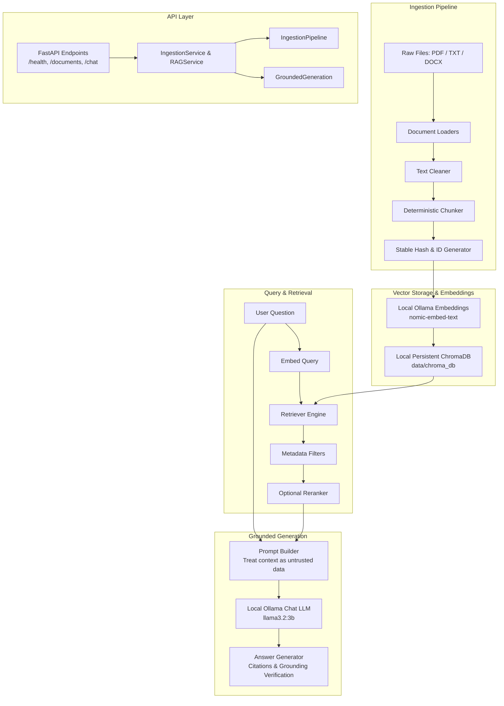

# LocalRAG Architecture Documentation

## Architectural Overview

LocalRAG is structured around clear separation of concerns, strict boundary isolation, and modular dependency injection. The design forbids monolithic script patterns and decouples ingestion, embedding, vector storage, retrieval, and LLM answer generation.

## Core Architectural Principles

1. **100% Offline & Private**: All inference and storage are performed locally. Cloud APIs and fallback services are forbidden.
2. **Explicit Interfaces**: Each subsystem exposes an abstract interface (`base.py`) decoupled from specific vendor implementations.
3. **Idempotent Ingestion**: Documents generate deterministic content hashes. Duplicate ingestion is prevented, and updates safely supersede previous chunks.
4. **Untrusted Evidence Boundary**: Retrieved document text is treated as untrusted data in prompts to mitigate indirect prompt injection.
5. **Traceable Citations**: Every generated statement must be traceable to specific chunk IDs and document sources.
6. **No Heavy Framework Coupling**: The core pipeline relies on explicit modules rather than black-box framework abstractions (e.g. LangChain or LlamaIndex).
